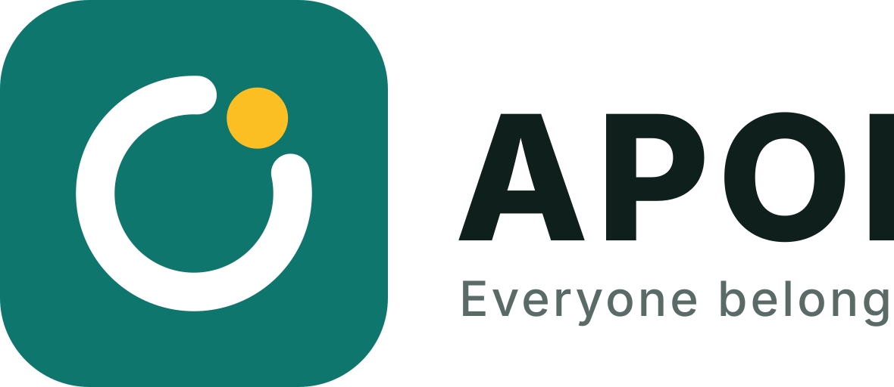

<p align="center"></p>

# APON — Everyone belongs

Bilingual (English / বাংলা) app that matches people anywhere in Bangladesh into small weekly circles of 4–6 and gives them hosted, real-world activities to meet at.

Next.js 16 (App Router, `proxy.ts`) · React 19 · Drizzle + PostgreSQL · Better Auth (phone/email OTP) · next-intl · Tailwind v4.

## Getting started

```bash
cp .env.example .env          # set DATABASE_URL and BETTER_AUTH_SECRET
npm install
npm run db:generate && npm run db:migrate
npm run db:seed               # demo data + the full location tree
npm run dev
```

Sign in with a seeded email (e.g. `admin@apon.app`). OTP codes are printed by the dev server.

## Locations (nationwide)

`areas` is one adjacency-list tree of **5,924 places**:

```
division → district → upazila → union → village
                    → city corporation → thana → area (Gulshan 2, Agrabad, …)
                                       → ward
```

- 8 divisions, 64 districts, 494 upazilas and 4,536 unions come from the BBS-derived
  [nuhil/bangladesh-geocode](https://github.com/nuhil/bangladesh-geocode) dataset
  (`lib/geo/data/bd-admin.json`, regenerate with `npm run geo:build`).
- 12 city corporations, 113 metropolitan thanas, 480 wards and 217 neighbourhoods are
  curated in `lib/geo/data/urban.ts`.
- Villages: no open nationwide dataset is bundled. Admins add villages and neighbourhoods
  under any union, thana or ward in **Admin → Locations**.
- `npm run geo:sync` upserts the tree by slug **without touching other data**, so it is
  safe on an existing database: users, venues and activities keep their location ids.
- Matching zones: neighbourhood clusters in Dhaka, city-wide elsewhere, by upazila in
  rural areas. Children inherit their parent's zone.

## Panels & access control

`lib/rbac.ts` is the single policy, used by the proxy, the layouts and the navigation:

| Section | Paths | Roles |
| --- | --- | --- |
| Public | `/`, `/guidelines`, `/credits` | anyone |
| Auth | `/sign-in`, `/verify` | signed-out only |
| User Panel | `/home`, `/activities`, `/circles`, `/profile`, `/settings`, `/host` | member, host, admin |
| Host tools | `/host/new`, `/host/:id/**` | host, admin |
| Admin Panel | `/admin/**` | admin |

Checks happen in three layers. `proxy.ts` handles redirects and returns real HTTP 403s.
Layouts and pages call `requireRole` / `requirePermission`, which use `forbidden()`.
Server Actions go through `createAction({ authorize })`. After sign-in, `/dashboard`
sends admins to the Admin Panel and everyone else to the User Panel.

## Scripts

| Script | What it does |
| --- | --- |
| `npm run test` | unit tests (matching, waitlist, actions, geo tree, RBAC) |
| `npm run test:e2e` | Playwright smoke test against a dev server |
| `node scripts/generate-icons.mjs` | regenerate PWA icons, Apple icon and favicon from the APON mark |
| `npm run geo:sync` | load/refresh the location tree only |
| `npm run matching` / `reminders` / `feedback` | scheduled jobs |

## Brand

**APON** (আপন — "one's own people"). Tagline: *Everyone belongs* · *সবাই আপন*.

The mark is an open ring (the circle) with a warm dot in its gap: there is always a place for you.
Sources: `public/brand/apon-mark.svg`, `public/brand/apon-logo.svg`, `app/icon.svg` (favicon),
`components/brand/logo.tsx` (in-app). Brand colours: teal `#0f766e`, amber `#fbbf24`.
